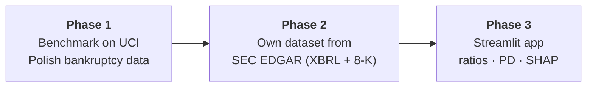
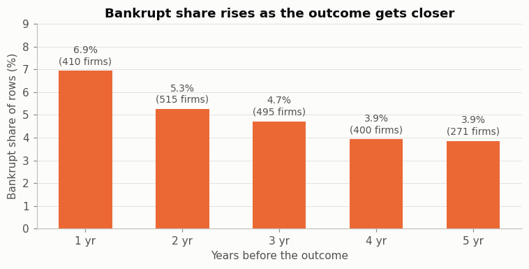
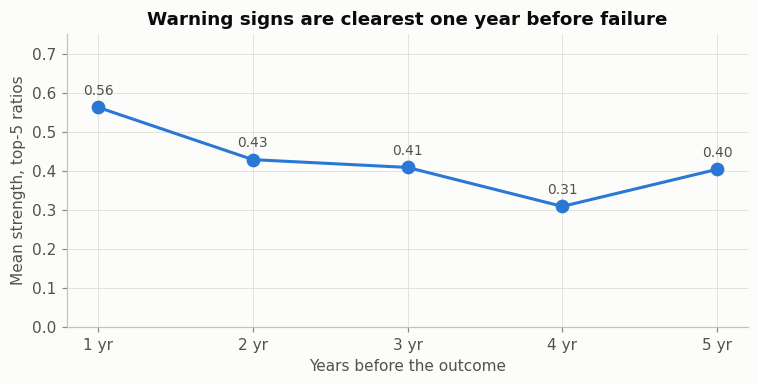
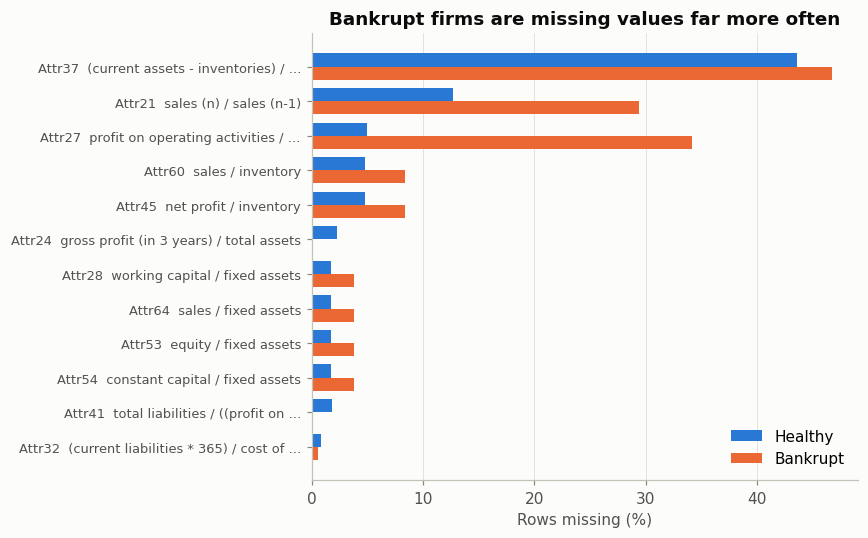
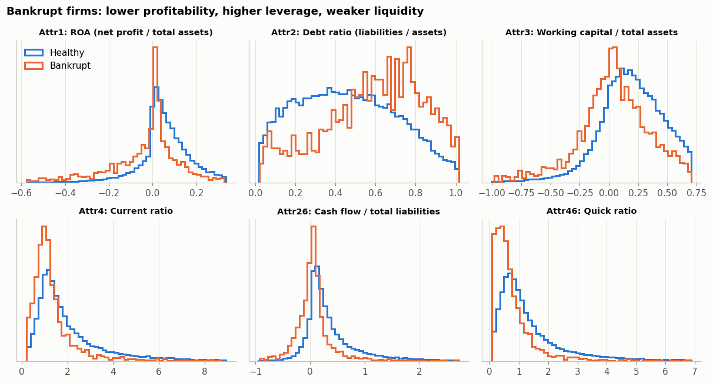
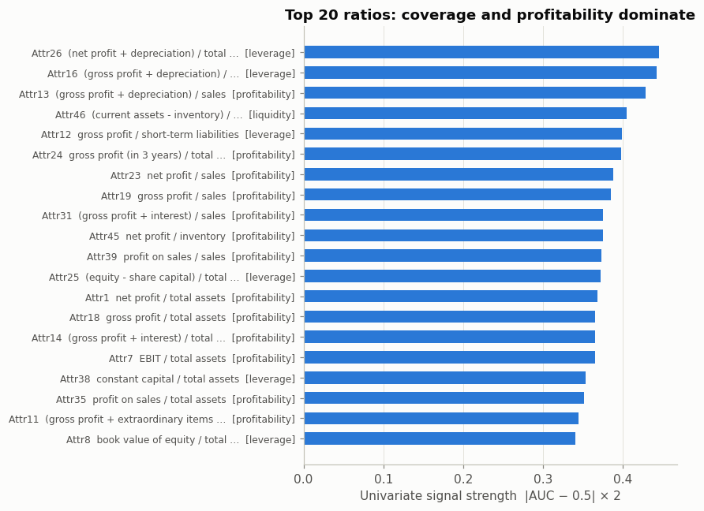
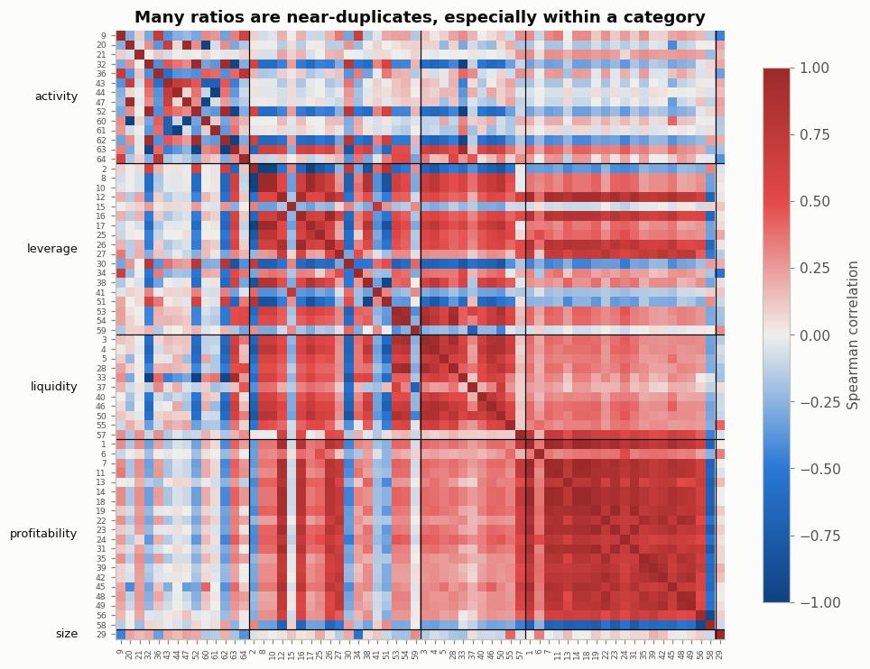

<div align="center">

# Corporate Credit Risk Prediction

**Predicting corporate financial distress from financial statement data, with calibrated probabilities and explainable drivers.**


[Overview](#overview) •
[Key findings](#key-findings-so-far) •
[Methodology](#methodology) •
[Roadmap](#roadmap) •
[Getting started](#getting-started) •
[Structure](#repository-structure)

</div>

---

## Overview

The long-term goal is a small **Corporate Financial Health & Risk Assessment** tool. You pick a company and get:

- 📊 its **key financial ratios** (profitability, liquidity, leverage, activity, size),
- 🎯 a **calibrated probability of financial distress**,
- 🔍 an **explanation of what drives that probability** (SHAP), compared with industry peers.

The project is built in three phases:



> [!NOTE]
> This is a research project, so decisions are justified and documented, and weaknesses are reported rather than hidden. Findings, including what didn't work, are recorded in the notebooks and in [`reports/`](reports/).

---

## Data

**Phase 1:** [UCI Polish Companies Bankruptcy dataset](https://archive.ics.uci.edu/dataset/365/polish+companies+bankruptcy+data)

| Property | Value |
|---|---|
| Rows | 43,405 financial statements |
| Features | 64 financial ratios (`Attr1`–`Attr64`) |
| Label | `class` (1 = bankrupt) |
| Horizons | 5 files; `Nyear.arff` holds data from **6 − N** years before the outcome |
| Bankrupt share | 3.9% – 6.9% depending on horizon |

Every attribute is mapped to its definition and to a category (profitability, liquidity, leverage, activity, size) in [`src/attributes.py`](src/attributes.py).

---

## Key findings so far

The full analysis is in [`notebooks/01_data_exploration.ipynb`](notebooks/01_data_exploration.ipynb).

<table>
<tr>
<td width="50%"></td>
<td width="50%"></td>
</tr>
<tr>
<td align="center"><sub>Class balance per horizon</sub></td>
<td align="center"><sub>Univariate signal by years before outcome</sub></td>
</tr>
</table>

| # | Finding | Decision |
|---|---|---|
| 1 | The horizon runs **opposite** to the file names (`1year` = 5 years before). | Use `years_before_outcome` everywhere. |
| 2 | Strong imbalance: 3.9–6.9% bankrupt. A model that always says "healthy" scores 93–96% accuracy. | No accuracy. Use PR-AUC, ROC-AUC, recall at a fixed FPR and Brier score. |
| 3 | 401 exact duplicate rows. | Drop them before splitting so copies can't end up in both train and test. |
| 4 | **Missingness predicts bankruptcy**: interest coverage (`Attr27`) is missing 7× more often for bankrupt firms. | LightGBM uses NaN natively. Logistic regression gets median imputation plus missing-indicator columns. |
| 5 | Extreme outliers from near-zero denominators (e.g. a gross margin of −1.1M). | Winsorise for logistic regression, fitted on training folds only. |
| 6 | `Attr7 = Attr14 = Attr18`; 35 pairs with \|ρ\| ≥ 0.95. | Drop exact copies, regularise, and read SHAP at category level as well. |
| 7 | Strongest single ratios: **cash flow to debt, margins, quick ratio**. | Consistent with credit theory. No single ratio is enough. |
| 8 | Signal is much stronger 1 year before the outcome than at 2–5 years. | Horizon choice is a trade-off between accuracy and early warning. |

<details>
<summary><b>More figures</b></summary>

<br/>

| Missingness by class | Key ratio distributions |
|---|---|
|  |  |

| Univariate signal per attribute | Spearman correlation |
|---|---|
|  |  |

</details>

---

## Methodology

These rules apply to every experiment in the project:

| Principle | How it is enforced |
|---|---|
| **No look-ahead** | Every feature must be available at the prediction date. In phase 2, filings are matched by *filing date*, not fiscal period end. |
| **Honest validation** | Chronological splits wherever dates exist. The UCI data has no dates or company IDs, so its split is stratified random. That is a stated limitation. |
| **No leakage from preprocessing** | Imputation, scaling, winsorising and resampling live inside sklearn `Pipeline`s and are fitted on training folds only. |
| **Imbalance-aware metrics** | PR-AUC, ROC-AUC, recall at a fixed false-positive rate and Brier score. Never accuracy alone. |
| **Calibration** | The output is a probability, so calibration curves are checked and the model is recalibrated if needed. |
| **Reproducibility** | Pinned dependencies, fixed random seeds, a checksum-verified data download. |

### Known limitations (phase 1)

- The dataset authors **pre-filtered** rows with a missing `Attr20` before publishing, so the sample is not random.
- There are **no company IDs**, so the same firm may appear in both train and test across horizons.
- Some ratios are only missing for healthy firms (`Attr24`, `Attr41`), which looks like a collection artefact. Models will be checked with SHAP to see whether they rely on it.

---

## Roadmap

**Phase 1: UCI benchmark**
- [x] Download script with checksum verification
- [x] ARFF loader with decoded labels and corrected horizon
- [x] Attribute dictionary (`AttrN` → definition → category)
- [x] Exploratory data analysis
- [ ] Define the prediction target, horizon and validation strategy
- [ ] Altman Z' score baseline
- [ ] Logistic regression baseline
- [ ] Gradient boosting (LightGBM) with calibration and SHAP

**Phase 2: SEC EDGAR dataset**
- [ ] Financials from the XBRL `companyfacts` / `frames` APIs
- [ ] Bankruptcy labels from 8-K Item 1.03 filings
- [ ] Point-in-time matching on filing dates
- [ ] Engineered ratios (D/E, current ratio, ROA, interest coverage, Altman inputs)

**Phase 3: App**
- [ ] Streamlit app: company lookup, ratios, distress probability, SHAP and peer comparison

---

## Getting started

```bash
# 1. Clone and set up an environment (Python 3.11+)
git clone https://github.com/rfreitas1/corporate-credit-risk-prediction.git
cd corporate-credit-risk-prediction
python -m venv .venv
source .venv/bin/activate        # Windows: .venv\Scripts\activate
pip install -r requirements.txt

# 2. Download the UCI data into data/raw/ (checksum-verified)
python -m src.download_data

# 3. Explore
jupyter lab notebooks/01_data_exploration.ipynb
```

Loading the data from Python:

```python
from src.data_processing import load_polish
from src.attributes import describe

df = load_polish()          # 43,405 rows, incl. years_before_outcome and class
print(describe("Attr1"))    # 'Attr1: net profit / total assets'
```

---

## Repository structure

```
corporate-credit-risk-prediction/
├── data/                  # not committed: created by src/download_data.py
│   ├── raw/
│   └── processed/
├── notebooks/
│   └── 01_data_exploration.ipynb
├── reports/
│   └── figures/           # figures produced by the notebooks
├── src/
│   ├── download_data.py   # UCI download + checksum check
│   ├── data_processing.py # ARFF loader
│   ├── attributes.py      # attribute dictionary and categories
│   └── eda.py             # reusable EDA helpers
├── requirements.txt
├── CLAUDE.md
└── README.md
```

---

## Tech stack

`pandas` · `numpy` · `scipy` · `scikit-learn` · `LightGBM` · `SHAP` · `matplotlib` · `JupyterLab` · *(phase 3)* `Streamlit`

## Data source and citation

Zięba, M., Tomczak, S. K., & Tomczak, J. M. (2016). *Ensemble boosted trees with synthetic features generation in application to bankruptcy prediction.* Expert Systems with Applications. Data: [UCI Machine Learning Repository](https://archive.ics.uci.edu/dataset/365/polish+companies+bankruptcy+data).
